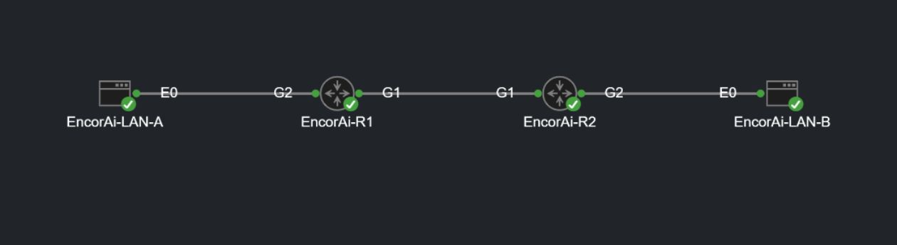
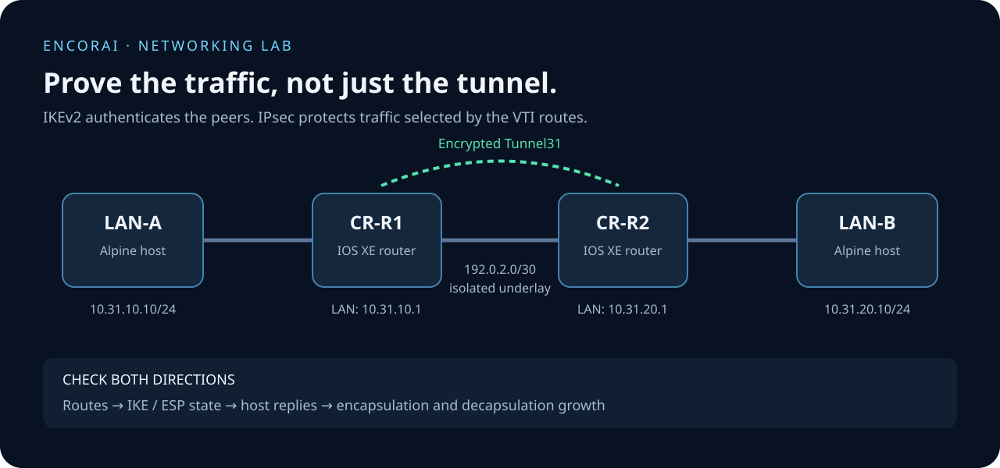

# IKEv2/IPsec VTI: prove the traffic, not just the tunnel

**EncorAI | Networking lab**

I'm documenting this lab to make one important distinction easier to understand: a tunnel can negotiate successfully without proving that traffic works end to end. Two IOS XE routers connect two Alpine hosts through a routed IPsec tunnel in an isolated four-node CML lab.

My focus here is the evidence: the IKEv2 state, traffic in both directions and IPsec counters. This is a learning project, not a production VPN template. The recorded lab run is from October 19, 2026; the packaged topology has not been re-imported or tested in a new CML deployment.

## The lab in CML



*A real screenshot of the existing lab on November 11, 2026. All four nodes showed green indicators; CML reported them as booted. The current labels are EncorAi-LAN-A, EncorAi-R1, EncorAi-R2 and EncorAi-LAN-B. This is a view of the topology, not a new tunnel or traffic test. [Capture details](docs/CML-SCREENSHOT.md).*

## How the tunnel fits together



*The diagram separates the physical underlay from the encrypted tunnel. The links and addresses match the included configurations.*

## What is here

- `topology.yaml`: JSON-compatible YAML for a new, isolated CML lab.
- `configs/`: four original synthetic startup configurations, preserved byte-for-byte.
- `docs/VERIFY.md`: setup, traffic checks, evidence interpretation and safe stopping points.
- `evidence/`: eight minimal excerpts from actual October 19, 2026 observations, plus an honest proof summary.
- `scripts/verify.py` and `tests/test_package.py`: offline structural, consistency and privacy checks. They make no network or CML calls.
- `docs/SECURITY.md` and `RIGHTS.md`: safety notes and usage rights.

## Historical result

On October 19, both routers reported IKEv2 `READY`. Each host sent five probes to the opposite LAN and received five replies with 0% loss. Both routers' encapsulation and decapsulation counters increased from 59 to 69 during the selected test window. These are dated observations, not a fresh run or a performance benchmark.

IKE `READY` alone does not demonstrate that a LAN packet traverses the tunnel and returns. Use the combination of routing, host traffic and counters. See [the proof and limits](docs/PROOF.md).

## Quick start: offline checks

Use Python 3.10 or newer. There are no third-party Python dependencies.

```sh
python3 scripts/verify.py
python3 -m unittest discover -s tests -v
```

On Windows, `py -3` can replace `python3`. These commands inspect local text files only. A PASS does not mean that a new CML deployment works.

## Reproduce in your own isolated CML environment

1. Review [SECURITY.md](docs/SECURITY.md). Never paste these configs into a real device or an existing shared lab.
2. Use your own licensed Cisco Modeling Labs installation. The historical source names CML 2.10.0+build.13, `csr1000v-17-03-08a` and `alpine-base-3-20-3`. No images are included. Different images or CML versions require their own validation.
3. Reserve at least 4 virtual CPUs and 7,168 MB of guest RAM, plus the CML server's own overhead. Check your installed image requirements and available storage separately.
4. Import `topology.yaml` as a **new disposable lab**. Confirm exactly four nodes and three links, with no external connector, NAT or bridge to a real network. Do not overwrite any existing lab.
5. Follow [VERIFY.md](docs/VERIFY.md), collect your own results and keep this package's historical evidence unchanged.

The topology's nodes, links and all four configs match the recorded source. Only its title, description and notes have been updated. The historical observations used renamed router labels; the included configs retain the startup hostnames `CR-R1` and `CR-R2`.

## Important limits

The PSK is an intentionally public demonstration string. Console authentication is disabled and sessions do not time out in these original lab-only configs. This lab is inappropriate for production or exposure to an untrusted network. Do not treat its crypto choices as a current production recommendation.

The selected evidence does not demonstrate fault diagnosis, repair, AWS integration, PFS rekey, application performance, path-MTU behavior or independent troubleshooting. No new CML deployment or traffic test was performed while preparing this repository.

## Technical references

- [Cisco IOS XE static VTI guide](https://www.cisco.com/c/en/us/td/docs/routers/ios/config/17-x/sec-vpn/b-security-vpn/m_sec-ipsec-virt-tunnl-0.html)
- [Cisco IOS XE IKEv2 configuration guide](https://www.cisco.com/c/en/us/td/docs/routers/ios/config/17-x/sec-vpn/b-security-vpn/m_sec-cfg-ikev2-flex.html)

These are vendor references for the technologies used in the lab. Cisco does not endorse this project.
