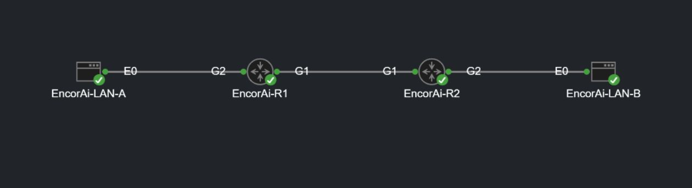

# The lab in CML

This is a real screen capture of the existing EncorAI IKEv2/IPsec lab in Cisco Modeling Labs, taken on November 11, 2026 at 15:40:04 UTC. It shows two LAN hosts connected through two routers. All four nodes displayed green indicators, and CML's Nodes table reported all four as `BOOTED`.

The current labels are `EncorAi-LAN-A`, `EncorAi-R1`, `EncorAi-R2` and `EncorAi-LAN-B`. The included startup configs use `LAN-A`, `CR-R1`, `CR-R2` and `LAN-B`, respectively. The left-to-right roles and physical interface connections correspond to the schematic in the README.

The capture was framed to include only the topology. Browser chrome, management addresses, account information, other labs and console output are outside the capture. The image has not been redrawn or generated, and no labels or status indicators were altered.

Only the existing topology and displayed node states were inspected. No devices were started, stopped or reconfigured, and no console commands or traffic tests were run for this screenshot. Green node indicators show that the nodes are running; they do not prove that the IPsec tunnel or end-to-end traffic works. The recorded traffic evidence in this repository remains the October 19, 2026 run.

Image: `cml-topology-2026-11-11.jpg`, JPEG, 1260 × 345 pixels. SHA-256: `486a7ed1df4c2a0a7289b828f16825a4ca0bd2aa85335439c7dfc443f6972105`.
